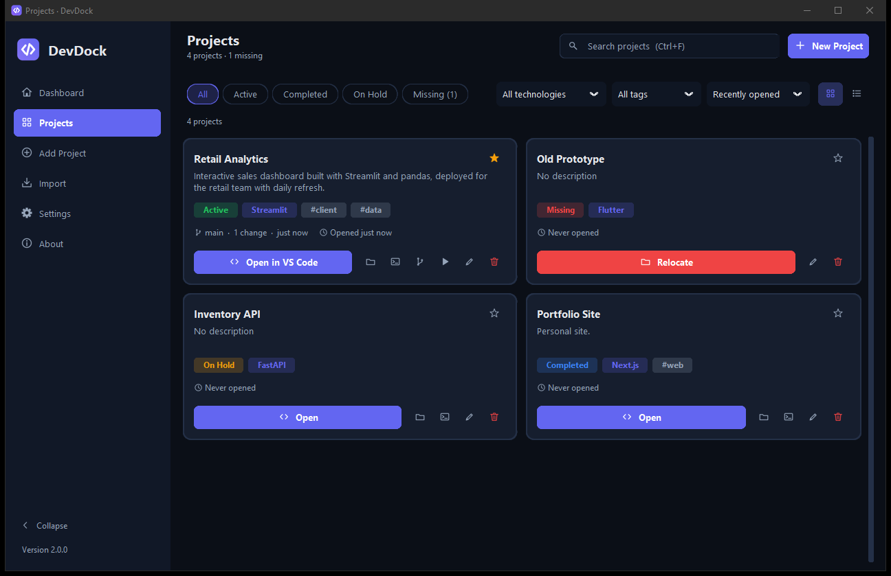
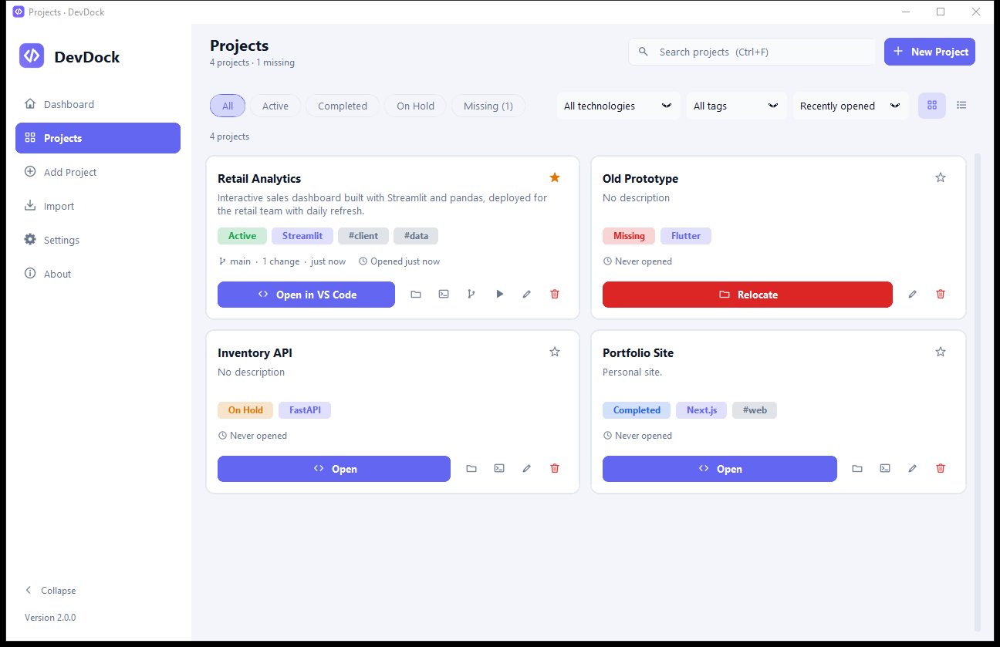
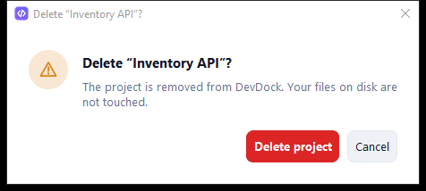
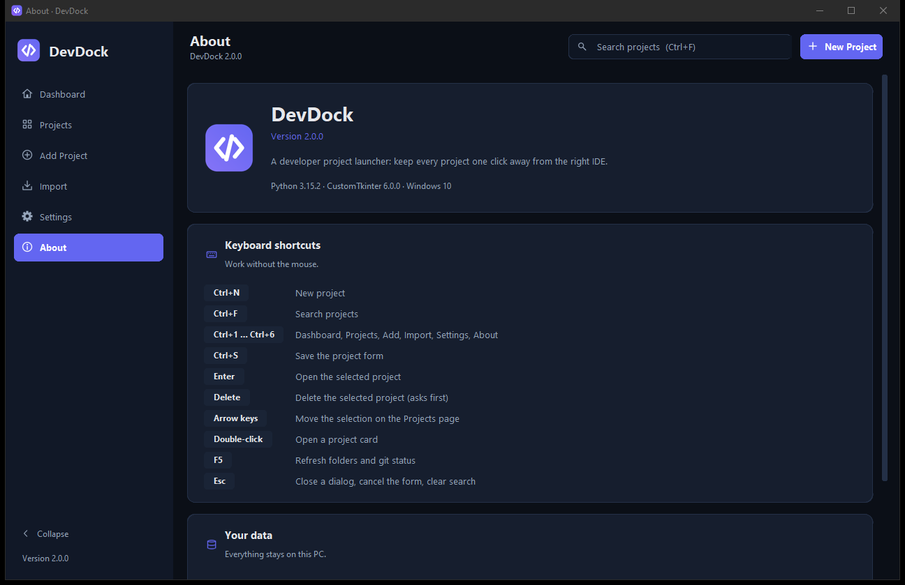
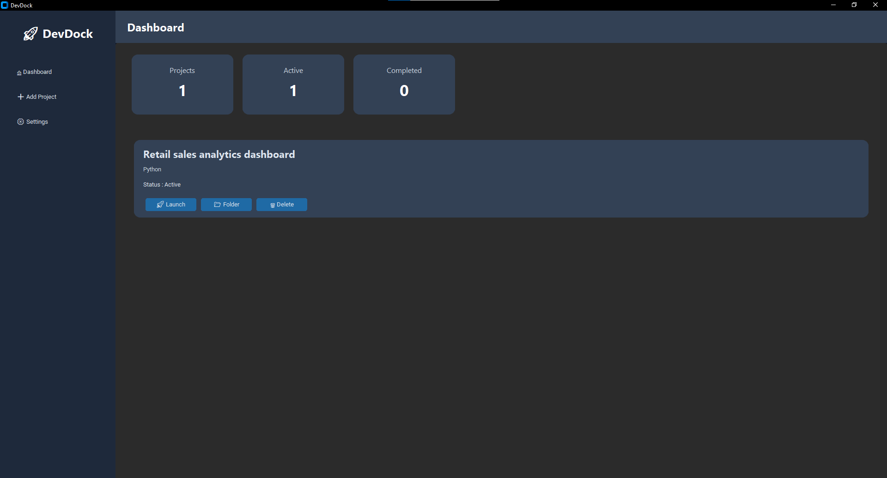
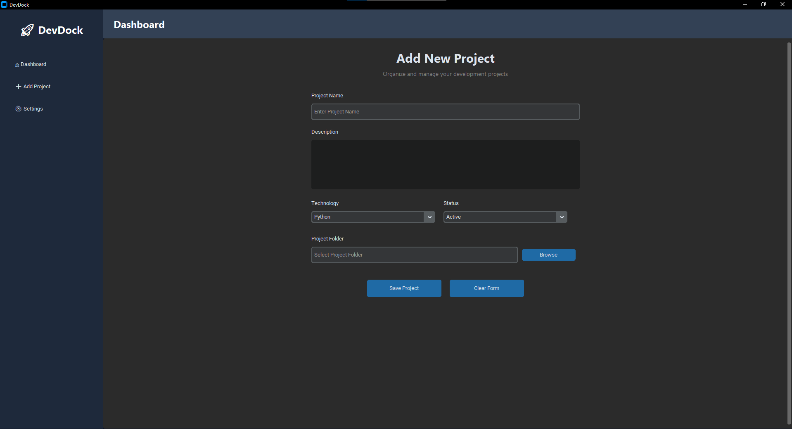

<div align="center">


# DevDock

**Every project one click away from the right IDE.**

[](https://github.com/Jvk1145/DevDock-v1.0/actions/workflows/tests.yml)


</div>

DevDock is a Windows desktop app that keeps track of your development projects and opens each one in the
right IDE with a single click. It also shows git status, runs your start command and finds missing folders.

---

## Features

- **One-click launch.** Each project remembers its preferred IDE. If it has none, DevDock uses your default IDE or asks once with a "Remember for this project" option.
- **Automatic IDE detection.** It finds VS Code, Cursor, PyCharm (Pro and Community), IntelliJ IDEA, Android Studio, Visual Studio, Sublime Text and Notepad++. It looks in per-user installs, Program Files, JetBrains Toolbox, `PATH` and `vswhere`.
- **Project cards with live git info.** Each card shows the branch, the number of changed files and the age of the last commit. Git runs in background threads with a timeout and a 60-second cache.
- **Quick actions.** Each card can open the folder in Explorer, open a terminal there (Windows Terminal or PowerShell), open the GitHub URL, or run the start command (for example `streamlit run app.py`) in a new terminal.
- **Missing folder detection.** Moved or deleted folders get a red **Missing** badge and a **Relocate** button.
- **Search, filters and sorting.** Search updates live as you type. You can filter by status, technology and tag, sort three ways, and switch between a responsive 2–4 column grid and a list view.
- **Smart add form.** The technology is detected from the folder contents. Validation errors appear inline, and Save stays disabled until every field is valid.
- **Bulk import.** Pick a parent folder, tick the sub-folders that look like projects, and add them all at once.
- **Dashboard.** It shows a greeting, statistics, pinned (starred) projects and recently opened projects.
- **Themes.** Dark, light or system mode, plus seven accent colours. Changes apply immediately.
- **Data tools.** Export and import JSON, create backups, restore backups and open the data folder.
- **Keyboard first.** Shortcuts cover every page, search, saving, launching and deleting.

## Screenshots

| Dashboard | Projects (grid) |
|---|---|
|  |  |

| Projects (list) | Light theme with emerald accent |
|---|---|
|  |  |

| Confirm dialog | About and shortcuts |
|---|---|
|  |  |

<details>
<summary>Version 1 screenshots</summary>




</details>

## Tech stack

| Area | Choice |
|---|---|
| Language | Python 3.12+ |
| UI | CustomTkinter 6 (Tk) with a token-based theme |
| Storage | SQLite (WAL mode, foreign keys, versioned migrations) |
| Images | Pillow (all icons are drawn in code, no icon font) |
| Tests | pytest (no UI, temp folders and databases) |
| Packaging | PyInstaller (one-folder build) and Inno Setup |
| CI | GitHub Actions on `windows-latest` |

## Architecture

```
app.py                  entry point: logging, DPI, single instance, error handler, start UI
config.py               version, constants, paths (%APPDATA%\DevDock)
│
├── core/               business logic; no Tk imports, fully unit-tested
│   ├── models.py           Project, IDE, GitInfo dataclasses
│   ├── database.py         connection, transactions, integrity check, backups/restore
│   ├── migrations.py       ordered schema migrations + schema_version table
│   ├── project_service.py  CRUD, search, filter, sort, favourites, tags, JSON import/export
│   ├── settings_service.py theme, accent, window state, defaults, IDE paths
│   ├── ide_detector.py     IDE discovery (user → Program Files → Toolbox → PATH → vswhere)
│   ├── launcher.py         argument-list commands for IDE / Explorer / terminal / browser
│   ├── git_service.py      branch, changes, last commit (thread pool, timeout, cache)
│   ├── tech_detector.py    technology from folder contents, import scanner
│   ├── validators.py       form rules shared by UI and services
│   ├── single_instance.py  named mutex + localhost activation socket
│   └── errors.py           exceptions that carry user-friendly messages
│
└── ui/                 CustomTkinter; talks to core services only (never SQL or subprocess)
    ├── theme.py            design tokens (colours, fonts, spacing, radius), dark + light
    ├── main_window.py      sidebar + top bar + page router, shortcuts, window state
    ├── actions.py          launch/open/edit/delete flows with friendly error recovery
    ├── async_runner.py     worker threads → queue → Tk main loop (after())
    ├── widgets/            Sidebar, TopBar, SearchBox, ProjectCard, StatCard, Badge, Chip,
    │                       Toast, dialogs (Modal, Confirm, Error, IDE chooser), EmptyState…
    └── pages/              dashboard, projects, project_form, import_projects, settings, about
```

Data flow: **UI event → `ui/actions.py` → core service → SQLite / subprocess**. Slow work such as disk scans, git
and IDE detection runs in a thread pool. Results come back to the UI thread through a queue that the Tk main loop
drains with `after()`.

## Reliability

- **Data in `%APPDATA%\DevDock`.** The database, logs and backups no longer depend on the working directory, so the app also works when installed in Program Files.
- **Versioned migrations.** Any DevDock 1.x database (both old layouts) upgrades without data loss. Duplicate names are renamed, not dropped. On first run, projects from the old `devdock.db` files are merged in automatically.
- **Automatic backups.** A backup is taken before every migration and once a day. The last 7 of each kind are kept. If the database is corrupt at startup, DevDock offers to restore the latest backup.
- **Safe database writes.** WAL mode is on, foreign keys are on, every write runs inside a transaction, all queries are parameterised, and `PRAGMA integrity_check` runs at startup.
- **No silent crashes.** `sys.excepthook`, `threading.excepthook` and Tk's `report_callback_exception` all log the full traceback. The user sees a "Something went wrong" dialog with **Copy details** and **Open log folder**.
- **Rotating logs.** Logs are written to `%APPDATA%\DevDock\logs\devdock.log` (1 MB × 5 files). Every launch, migration and error is recorded.
- **Single instance.** Starting DevDock a second time brings the running window to the front.
- **Checks before launching.** DevDock verifies the folder and the IDE executable before starting anything. Problems open a dialog with a fix such as **Locate folder** or **Fix IDE path**. Processes start from argument lists, never `shell=True`, and run detached.
- **Responsive UI.** Disk, git and detection work never blocks the UI thread.
- **Windows polish.** Per-monitor DPI awareness gives sharp text. Window size, position and maximised state are remembered and clamped to the visible screen.

## Run from source

```powershell
git clone https://github.com/Jvk1145/DevDock-v1.0.git
cd DevDock-v1.0
python -m venv .venv
.venv\Scripts\activate
pip install -r requirements.txt
python app.py
```

To use a different data folder, for example a portable copy or a test run, set `DEVDOCK_HOME`:

```powershell
$env:DEVDOCK_HOME = "D:\DevDockData"; python app.py
```

## Build

```powershell
build.bat
```

`build.bat` installs the requirements, runs the tests, regenerates the icons and builds `dist\DevDock\DevDock.exe`
with PyInstaller. The build is windowed, one-folder, has the app icon and does not use UPX. If
[Inno Setup](https://jrsoftware.org/isinfo.php) is on `PATH`, it also creates `installer_output\DevDock_Setup.exe`
with a Start Menu shortcut and an optional desktop shortcut.

To regenerate only the icons, run `python scripts/make_icon.py`.

## Test

```powershell
python -m pytest -q
```

The suite needs no display. It covers:
- migrations from an empty database and from both 1.x layouts
- project CRUD, search, filters, sorting, favourites, import and export
- validators, tech detection, and IDE detection with fake folders and a fake `PATH`
- launcher command building, without starting real programs
- git status on a temporary repository, skipped when git is missing
- backup and restore, the single-instance guard, and the data-folder override

## Keyboard shortcuts

| Shortcut | Action |
|---|---|
| `Ctrl+N` | New project |
| `Ctrl+F` | Search projects |
| `Ctrl+1` … `Ctrl+6` | Dashboard, Projects, Add, Import, Settings, About |
| `Ctrl+S` | Save the project form |
| `Enter` | Open the selected project |
| `Delete` | Delete the selected project (asks first) |
| Arrow keys | Move the selection on the Projects page |
| Double-click | Open a project card |
| `F5` | Refresh folders and git status |
| `Esc` | Close a dialog, cancel the form, clear the search |

## Roadmap

- Run commands with their output shown inside DevDock
- Per-project environment profiles, such as activating a venv before running
- Workspaces that open several projects together
- Automatic updates through GitHub Releases
- Optional cloud sync of the project list
- macOS and Linux support (core is already platform-neutral; the launcher and detector need adapters)

## Interview talking points

- **Layered architecture.** `core/` has no Tk imports and is fully unit-tested. The UI only calls services, which made the rewrite testable and removed SQL and subprocess calls from widget classes.
- **Schema migrations.** Two incompatible legacy schemas were read by tuple index, so the saved IDE was effectively never used. The fix was `sqlite3.Row`, a `Project` dataclass and ordered migrations with a `schema_version` table. Each migration runs in a transaction and is preceded by a backup.
- **Threading with Tk.** Tk is not thread-safe. Workers only put results on a queue, and the main loop drains it with `after()`. Callbacks are dropped if their widget has been destroyed.
- **Safe process launching.** Commands are argument lists, never a shell. Start commands are passed to PowerShell with `-EncodedCommand`, so no quoting bugs or injection through `;` are possible, even inside Windows Terminal.
- **IDE detection without leaking across users.** The old code globbed `C:\Users\*`. Now only the current user's `%LOCALAPPDATA%` is searched, followed by Program Files, Toolbox, `PATH` with `.cmd` shim resolution, and `vswhere`. Every step is injectable for tests.
- **Production habits.** The project has rotating logs, global exception hooks, a single-instance mutex, DPI awareness, window-state persistence, an integrity check with backup restore, CI on Windows, and an antivirus-friendly build without UPX.
- **Design system.** Colours, type scale, spacing and radius live in one `theme.py`. The tokens are injected into CustomTkinter's theme engine, so light and dark switch live and accent colours rebuild the UI on demand.
