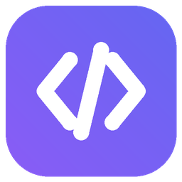
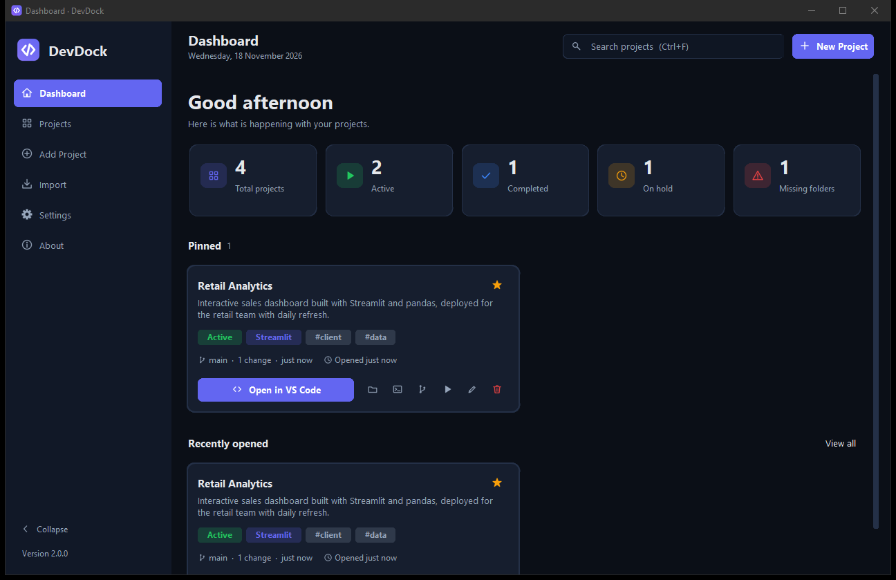
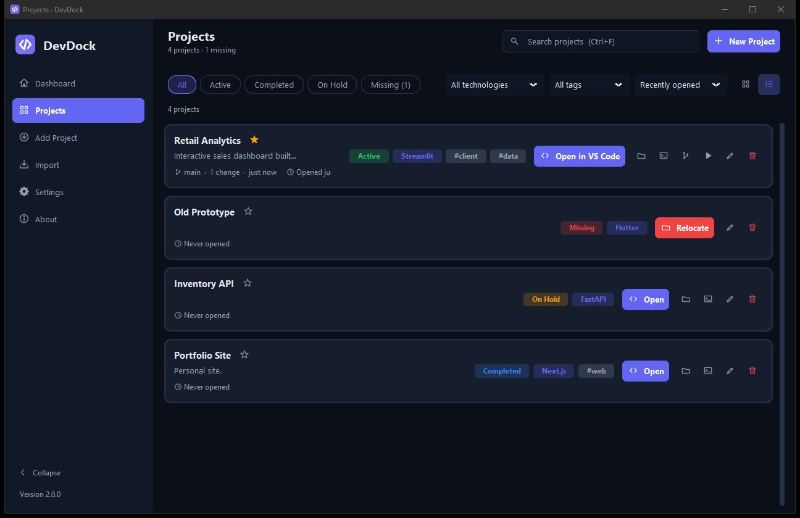

# DevDock

[](https://github.com/Jvk1145/DevDock-v1.0/actions/workflows/tests.yml)

A small Windows app I built to keep all my coding projects in one place and open them in the right IDE with one click.

I had projects spread across different folders and kept opening the wrong editor or hunting for the folder. DevDock fixes that. You add a project once, pick which IDE it should open in, and from then on it's one click.



## What it does

- Opens each project in the IDE you chose for it (VS Code, PyCharm, IntelliJ, Android Studio, Cursor, Visual Studio, Sublime Text, Notepad++)
- Finds the IDEs installed on your PC automatically
- Shows the git branch and how many files you've changed
- Opens the project folder, a terminal, or the GitHub page from the card
- Runs your start command, like `streamlit run app.py`
- Warns you when a project folder has been moved or deleted
- Search, filter by status or technology, and add tags
- Import a whole folder of projects at once
- Dark and light themes

## Screenshots

| Projects | List view |
|---|---|
|  |  |

| Light theme | About |
|---|---|
|  |  |

## Running it

You need Python 3.12 or newer on Windows.

```powershell
git clone https://github.com/Jvk1145/DevDock-v1.0.git
cd DevDock-v1.0
python -m venv .venv
.venv\Scripts\activate
pip install -r requirements.txt
python app.py
```

Your projects and settings are saved in `%APPDATA%\DevDock`.

## Building the .exe

```powershell
build.bat
```

This runs the tests and builds `dist\DevDock\DevDock.exe` with PyInstaller. If you have [Inno Setup](https://jrsoftware.org/isinfo.php) installed, it also makes an installer.

## Tests

```powershell
python -m pytest
```

## Built with

- Python
- CustomTkinter for the UI
- SQLite for storage
- Pillow for the icons
- pytest and GitHub Actions for testing

## How the code is organised

```
app.py      starts the app
core/       database, project logic, IDE detection, launching, git
ui/         windows, pages and widgets
tests/      tests for everything in core/
```

The UI never talks to the database directly. It goes through the code in `core/`, which made the logic easy to test without opening any windows.

## Shortcuts

| Keys | Action |
|---|---|
| Ctrl+N | New project |
| Ctrl+F | Search |
| Ctrl+1 to Ctrl+6 | Switch pages |
| Ctrl+S | Save |
| Enter | Open selected project |
| Delete | Delete selected project |
| F5 | Refresh |

## Ideas for later

- Show the output of running commands inside the app
- Open several projects together as a workspace
- Auto-update from GitHub releases
- macOS and Linux support

## Version history

- **v2.0** Full rewrite: new design, git info, project import, themes, backups and tests
- **v1.0** First version with project list and IDE launching ([screenshots](docs/screenshots/v1-dashboard.png))
